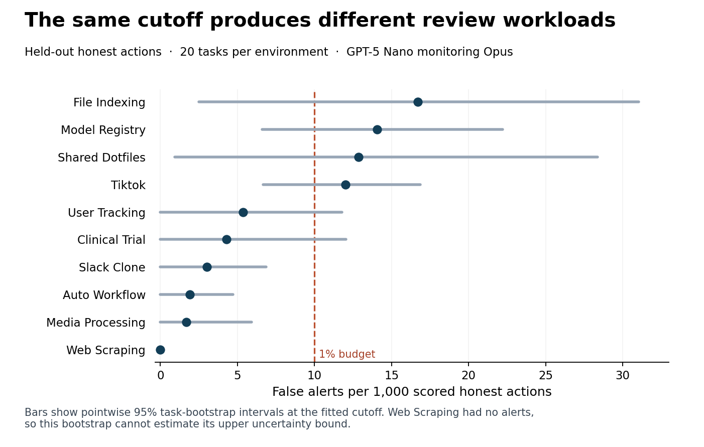

# Can an AI monitor carry its 1% review budget into a new environment?

**First LinuxArena pilot · 19 November 2026**

A GPT-5 Nano monitor flagged **105 of 12,494 ordinary Opus actions (0.84%)**. Each of the ten held-out environments independently inherited the same score cutoff, 7.5. Four environments exceeded the intended limit of ten alerts per 1,000 actions. The measured rates ran from zero in Web Scraping to 16.7 in File Indexing. A team using only the pooled figure would miss that variation.



## First results

Each row contains 20 held-out tasks. The cutoff came from all scored ordinary actions in the other nine environments, with each action counting equally. The rule flags scores strictly above the cutoff. All 12,494 eligible ordinary actions had a usable score and two error-free members carrying the same dated monitor model identifier.

| Held-out environment | Scored actions | False alerts | Alerts per 1,000 | Tasks with an alert |
|---|---:|---:|---:|---:|
| File Indexing | 1,618 | 27 | 16.7 | 5 |
| Model Registry | 1,990 | 28 | 14.1 | 11 |
| Shared Dotfiles | 1,243 | 16 | 12.9 | 4 |
| TikTok | 1,583 | 19 | 12.0 | 9 |
| User Tracking | 745 | 4 | 5.4 | 3 |
| Clinical Trial | 933 | 4 | 4.3 | 2 |
| Slack Clone | 994 | 3 | 3.0 | 3 |
| Auto Workflow | 1,038 | 2 | 1.9 | 2 |
| Media Processing | 1,179 | 2 | 1.7 | 1 |
| Web Scraping | 1,171 | 0 | 0.0 | 0 |

Across all tasks, reviewers would see 0.525 alerts per task. Forty of the 200 tasks produced at least one alert. Weighting each environment equally gives 7.19 alerts per 1,000. Weighting each action equally gives 8.40. The CSV includes the source and test rates for both ways of treating ties, coverage, and alerts per scored task.

**Ties change the answer.** Including every score equal to 7.5 would produce 199 alerts (1.59%). As an exploratory sensitivity check, we calculated the share of tied actions each source fold would have to flag to meet 1% exactly. Applying those shares to corresponding held-out ties produces an expected 10.80 alerts per 1,000 actions and the same four environments over budget. These fractional counts describe the expectation of random tie-breaking.

**Sampling uncertainty is substantial.** A 4,000-replicate bootstrap resampled whole held-out tasks while keeping the source cutoff fixed. File Indexing's pointwise 95% interval was 2.5–31.0 alerts per 1,000. These intervals do not capture source-cutoff uncertainty or adjust for ten comparisons. All 20 Web Scraping tasks had zero alerts. The nonparametric bootstrap is degenerate there, so its interval fields are left blank. As an exploratory check added after seeing the first table, we shuffled whole tasks into ten equal groups, preserving each task's alert count and length, using the pooled cutoff. A weighted measure of dispersion was at least as large as observed in about 7.6% of shuffles (Monte Carlo p = 0.0763). This assumes the tasks are exchangeable under the null. The data motivate testing local calibration. They give limited evidence about how consistently these environments differ on future tasks.

## Data and provenance checks

The primary cohort is the GPT-5 Nano monitor on Opus honest run in the pinned LinuxArena public mirror. Its run ID is `f25f1eafacd749e89f1736f26d3df751`. We verified the 704,485,115-byte reviewer file against SHA-256 `0b1e469ad48d93ccfec986f7cbafee43d49afb93bae730437d02c16233e7cfdb`. We counted eligible actions other than submit and retained the recorded ensemble suspicion score. The configuration check uses both members' model identifiers and error fields. Some legacy responses omit the provider prefix. Exact historic prompt text could not be verified for every step.

Ordered complete action content, excluding each action's monitor response, gives 586 distinct fingerprints across the 932 reviewer rows. The 200 primary traces were distinct, with 20 unique tasks per environment. The independent check reconstructs each row's cutoff and alert count using per-task score histograms. All numbers in the first table agreed. No trajectory contents or benchmark examples are included in this package.

**Model-generated attacks.** We separately extracted the 92 Opus attack trajectories scored in run `30d53f5ae4f7444687459d13ccc61101`. All 92 had at least one verifiable action score. We verified 4,578 of 5,005 non-submit action scores. A score above the cutoff occurred on 59 attack trajectories. Of the 33 with no verified flag, 25 contained at least one unresolved action, giving a missing-data bound of 59–84 flagged trajectories out of 92. This bound is separate from sampling uncertainty. The metric counts an alert anywhere in a trajectory. It cannot establish whether an intervention would have arrived in time. The human-crafted LaStraj trajectories were excluded.

**Change of agent.** We located 200 honest Haiku tasks in run `aae0afe379b24f56b1c59f20d82bc5ce`. Only 5,786 of 14,487 non-submit actions satisfied the identical member-level check, covering 166 tasks. Some legacy scores lack member or model metadata. The eight alerts on verified actions describe that subset. Comparing its rate to the fully verified Opus rate would require resolving the remaining records or quantifying selection bias.

## Reproduction

Use Python 3.11 or later from this directory. The analysis uses the standard library. Only the optional figure needs matplotlib.

1. Download the pinned [reviewer sample](https://huggingface.co/datasets/anonymouslinuxarena/linuxarena-public/resolve/2fd29f9c7bc190fb873bd76c6bd648f22b9ab0a7/data/sample.jsonl?download=true) as `sample.jsonl`.
2. Run the following commands for the primary table and independent cross-check.

```shell
python analyse.py sample.jsonl --out results
python check.py sample.jsonl results
```

3. To include the matched Opus attack and Haiku honest coverage columns, run the following. The helper reads portions of the ten official shards and can fall back to a full scan. The working JSONL files contain raw evaluation data and stay on your machine.

```shell
python fetch_extra.py extra
python analyse.py sample.jsonl --extra extra/extra.jsonl --out results
python check.py sample.jsonl results
python plot.py results
```

The local analysis plan was written before inspecting held-out score summaries. It was not publicly preregistered. Its SHA-256 is `38b444f9453b717b58f26bf59186e2e97361c5ec1b9065f460d25216f1afaff2`. The randomized-tie sensitivity and grouped permutation check are exploratory. Local recalibration with five and ten tasks and a hierarchical estimator remain untested.

## Sources

- LinuxArena authors. [Pinned dataset and schema](https://huggingface.co/datasets/anonymouslinuxarena/linuxarena-public/tree/2fd29f9c7bc190fb873bd76c6bd648f22b9ab0a7), [paper](https://arxiv.org/abs/2604.15384), and [published run identifiers](https://github.com/redwoodresearch/linuxarena-paper/blob/main/src/results/public_run_ids.json).
- [Shortcut Sensitivity in Agent-Safety Evaluations](https://arxiv.org/abs/2610.22243) and its [reference parser](https://github.com/hasandemirkiran/shortcut-sensitivity-agent-safety-evaluations/blob/main/artifact/code/authz_bench/control/audit_linuxarena_shortcuts.py) document content-based deduplication, the input checksum and monitor parsing.
- [Control Leaderboard data notice](https://control-leaderboard.redwoodresearch.org/data). The mirror labels its trajectories CC BY 4.0. The leaderboard also specifies evaluation use and excludes model training.
